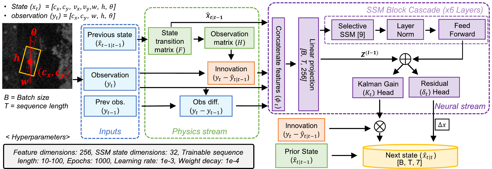

# SSM_KF
Parallel Kalman filtering with physics-informed selective state-space models for radar tracking (IMS RFSA 2026)

This release includes the model architecture, training code, and clean-condition evaluation.

## System architecture

*Figure from Park et al., IEEE IMS RFSA 2026.*

- Physics stream: the known constant-velocity model (F, H) gives the kinematic prior and the innovation
- Neural stream: a 6-layer selective SSM (Mamba-1) cascade processes the whole track window in parallel
- Kalman-gain and residual heads give the update `x_{t|t} = x_{t|t-1} + K_t i_t + 0.1 δ_t`
- The released checkpoint was trained for 5000 epochs.

## Setup
```bash
conda create -n ssm_kf python=3.10 -y && conda activate ssm_kf
pip install -r requirements.txt
pip install mamba-ssm==2.2.6.post3 --no-build-isolation   # optional: CUDA kernels
```
Without `mamba-ssm`, add `--ssm_type mamba1` to use the pure-PyTorch layer; it loads the same weights. CPU runs use it automatically.

### Data
Download [RADIATE](https://pro.hw.ac.uk/radiate/) with the [official SDK](https://github.com/marcelsheeny/radiate_sdk), then arrange the sequences as follows:
```
data/radiate/train/  city_1_0 city_1_1 city_1_3 city_2_0 city_3_0 city_3_1 city_3_2 city_4_0 city_6_0 fog_8_0
                     junction_1_0 ... junction_1_5 junction_2_0 junction_2_2 junction_3_0 junction_3_1
                     night_1_0 night_1_2 night_1_3 night_1_5 rain_2_0
data/radiate/test/   city_7_0 fog_6_0 junction_1_10 night_1_4 rain_4_0
```
Only `annotations/annotations.json` is needed. Fig. 5 also needs `Navtech_Cartesian/`.

### Checkpoints
Download from the [v1.0 release](https://github.com/jpark3263/SSM_KF/releases/tag/v1.0):
```bash
mkdir -p checkpoints/ssm_physics_10frames checkpoints/knet
wget -O checkpoints/ssm_physics_10frames/best_model.pth https://github.com/jpark3263/SSM_KF/releases/download/v1.0/ssm_physics_10frames.pth
wget -O checkpoints/knet/best_model.pth https://github.com/jpark3263/SSM_KF/releases/download/v1.0/knet.pth
```

## Usage
```bash
# Training
python train/train_SSM_physics.py --use_cuda   # 5000 epochs, batch 32, lr 1e-3, wd 1e-4
python train/train_KNet.py --use_cuda          # KalmanNet baseline: 25 epochs, batch 8, lr 1e-3

# Clean test-set evaluation (KF / KalmanNet / SSM)
python run.py --use_cuda                       # 10-frame tracks
python run.py --use_cuda --seq_len 20          # 20-frame tracks

# Fig. 5: predicted boxes on radar frames -> results/fig5/
python scripts/fig5_visualize.py --use_cuda
```

### Clean results (10-frame tracks, 1,169 test sequences)
| Model | Params | MSE (dB) | 5-step MSE (dB) |
|---|---|---|---|
| Classic KF | 0 | 20.02 | 20.99 |
| KalmanNet | 375,972 | −22.75 | −21.94 |
| Selective SSM | 4,435,754 | **−28.21** | **−29.70** |

5-step MSE: MSE over the last 5 frames of each window.

The paper's clean KF MSE (8.84 dB) and its clean 5-step values (KF 21.53 dB, SSM −27.54 dB) were computed on 20-frame tracks. The KF MSE cell uses position-only MSE. `python run.py --seq_len 20` reproduces all three.

The 10-frame results were reproduced on an NVIDIA RTX 6000; the 20-frame results on CPU with the pure-PyTorch layer. The software was PyTorch 2.9.1 and mamba-ssm 2.2.6.post3. Inference times depend on the hardware; the paper used an NVIDIA RTX 4060.

## Contact
* Jinhyeok Park E-mail: jpark3263@gatech.edu

## Citation
```bibtex
@INPROCEEDINGS{11624260,
  author={Park, Jinhyeok and Padhy, Apurba Prasad and Cho, Han and Mukhopadhyay, Saibal},
  booktitle={2026 IEEE MTT-S Radio Frequency Systems and Applications Symposium (IMS RFSA)}, 
  title={Parallel Kalman Filtering with Physics-Informed Selective State-Space Models for Robust Radar Sensing}, 
  year={2026},
  volume={},
  number={},
  pages={63-66},
  keywords={Modeling;Kalman filters;Sequences;Sequential analysis;Timing;Physics;Measurement;Printing;Equations;Gain;Kalman filtering;physics-informed learning;radar perception;state-space model},
  doi={10.1109/IMSRFSA70221.2026.11624260}}

```

This work was supported in part by COGNISENSE, one of seven centers in JUMP 2.0, a Semiconductor Research Corporation (SRC) program sponsored by DARPA.

The KalmanNet baseline is adapted from [KalmanNet_TSP](https://github.com/KalmanNet/KalmanNet_TSP). Released under the MIT License.
